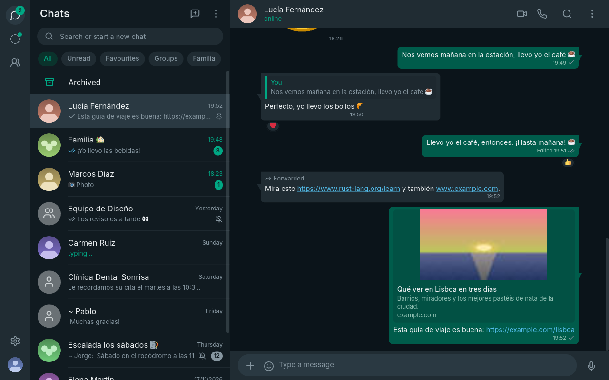
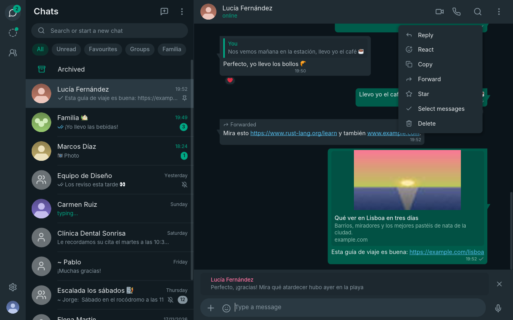
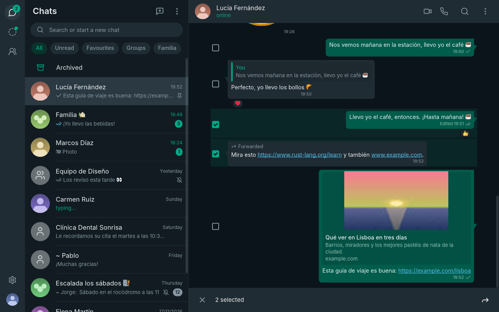
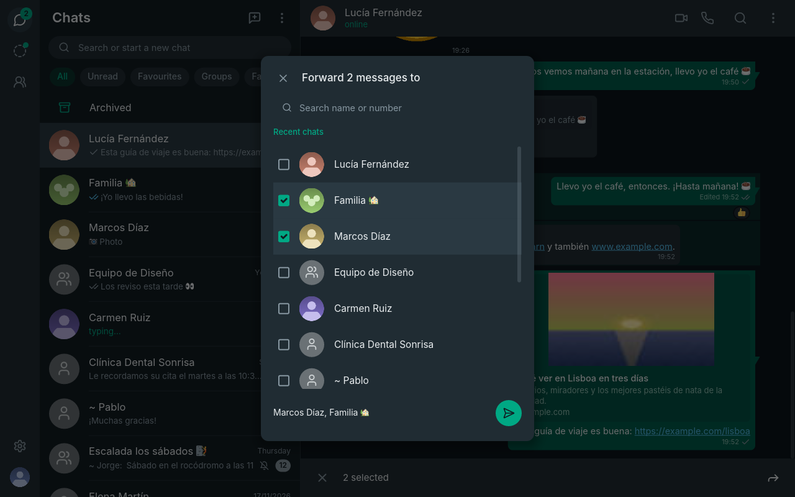
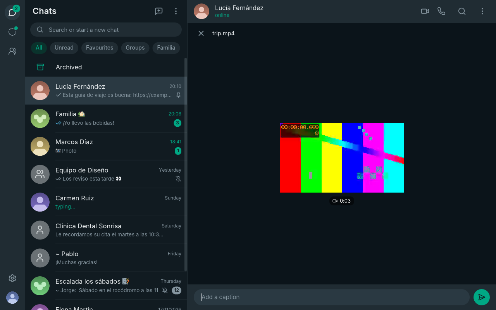
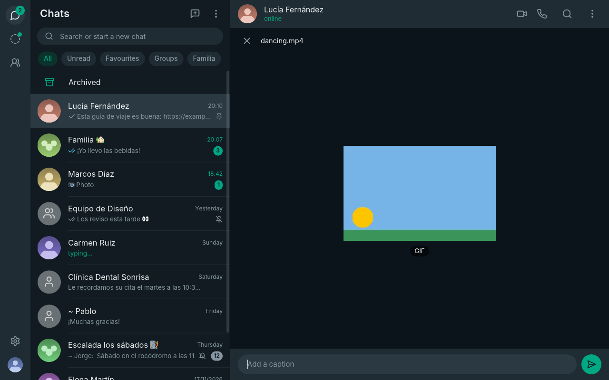
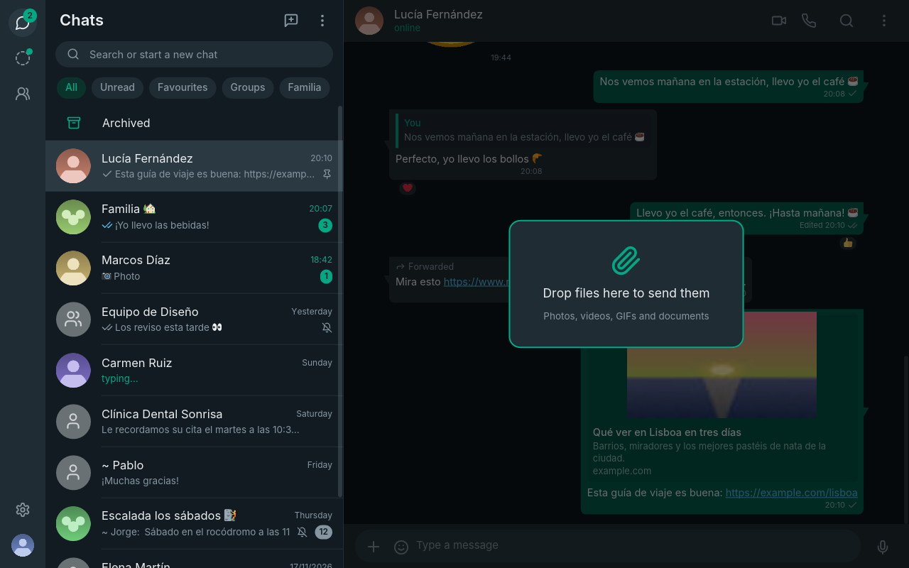
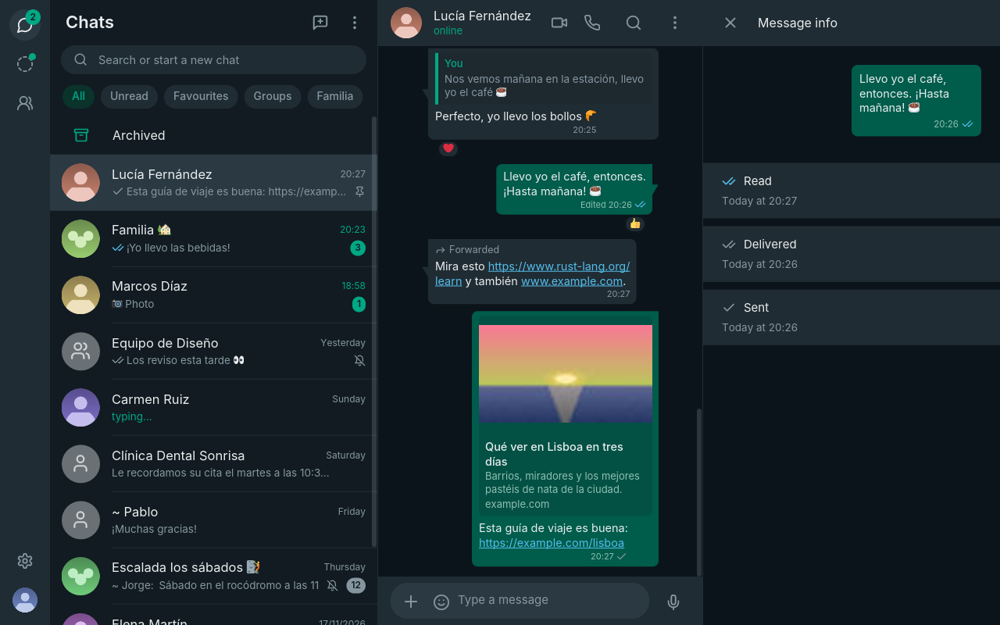
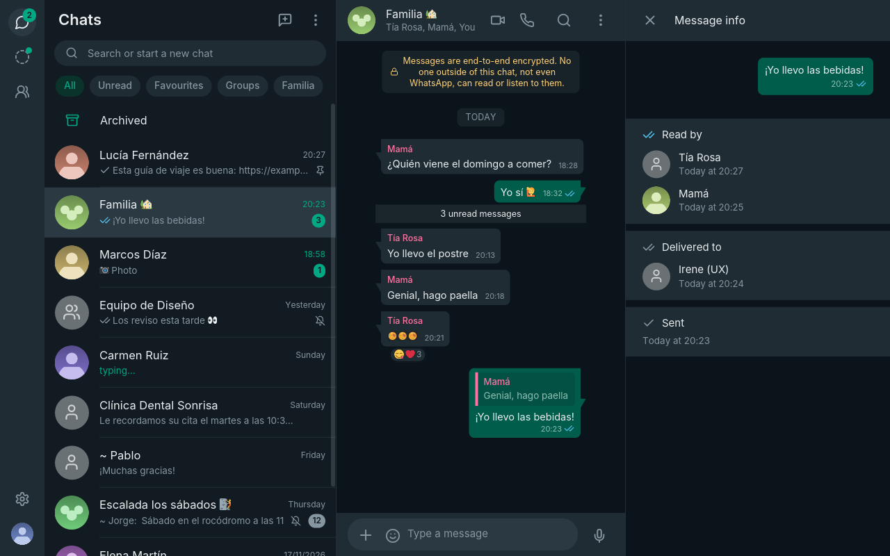

# Ferrochat

A lightweight, native WhatsApp desktop client written in Rust. It links to
your phone as a companion device (like WhatsApp Web / Desktop), using the
pure-Rust [`whatsapp-rust`](https://github.com/jlucaso1/whatsapp-rust)
implementation of the multi-device protocol, and draws its UI with
[`iced`](https://iced.rs) in a look that closely follows WhatsApp Desktop's
dark theme.

> [!WARNING]
> **Unofficial client.** Ferrochat is not affiliated with, endorsed by or
> supported by WhatsApp or Meta. **Third-party clients break WhatsApp's
> terms of service and can get your account temporarily or permanently
> banned.** Use it at your own risk, ideally with an account you can afford
> to lose. No WhatsApp logos, icons or fonts are shipped; the look is
> recreated with Inter (OFL) and Lucide icons (ISC).

## Install / update

Linux x86_64, no root needed. One command installs and updates (it downloads
the latest [release](https://github.com/Kartudev/Ferrochat-kartu/releases/latest), checks
its SHA-256 and puts the binary, menu entry and icon under `~/.local`):

```sh
curl -fsSL https://raw.githubusercontent.com/Kartudev/Ferrochat-kartu/main/install.sh | sh
```

Uninstall (removes only what the installer added, never your account data):

```sh
curl -fsSL https://raw.githubusercontent.com/Kartudev/Ferrochat-kartu/main/install.sh | sh -s -- --uninstall
```

Manual alternative: download `ferrochat-vX.Y.Z-linux-x86_64.tar.gz` and its
`.sha256` from the Releases page, then:

```sh
sha256sum -c ferrochat-*-linux-x86_64.tar.gz.sha256
tar xzf ferrochat-*-linux-x86_64.tar.gz
./ferrochat-*-linux-x86_64/ferrochat
```

The tarball also has `packaging/dev.ferro.ferrochat.desktop` and `.svg` if you want
a menu entry. Releases are built on Ubuntu 22.04 (glibc 2.35).

### Windows

Windows 10/11 x86_64, no admin rights needed. In PowerShell:

```powershell
irm https://raw.githubusercontent.com/Kartudev/Ferrochat-kartu/main/install.ps1 | iex
```

It installs into `%LOCALAPPDATA%\Programs\Ferrochat` with a Start Menu shortcut.
Uninstall (program folder, shortcut and "start at login" only):

```powershell
& ([scriptblock]::Create((irm https://raw.githubusercontent.com/Kartudev/Ferrochat-kartu/main/install.ps1))) -Uninstall
```

Or download `ferrochat-vX.Y.Z-windows-x86_64.zip`, check it against its
`.sha256` (`Get-FileHash`), unpack it anywhere you can write to and run
`ferrochat.exe`. That folder updates itself too. Closing the window keeps
Ferrochat in the notification area (tray icon), like on Linux.

Ferrochat checks for a new release when it starts and every few hours, and
shows a slim banner when one is out. Installs made with `install.sh` (or the
Windows zip / `install.ps1`) update
in place from the banner or Settings → Updates (download, SHA-256 check,
atomic replace, then "Restart now"). A `cargo install` copy shows the cargo
command instead, and other installs link to the release page. Turn the
automatic check off in Settings; it only asks GitHub for the latest release.



| Reply and menu | Reactions | Search in chat |
|---|---|---|
|  |  |  |

| Select messages | Forward |
|---|---|
|  |  |

| Send a video | Send a GIF | Drag and drop |
|---|---|---|
|  |  |  |

| Message info | Message info in a group |
|---|---|
|  |  |

## Features

* QR-code pairing as a linked device (codes refresh automatically, reload
  when they run out), logout / unlink.
* Chat list with search, filter chips (All / Unread / Favourites / Groups),
  unread badges, pinned and muted markers, last-message preview with ticks.
* History from WhatsApp's history sync, cached in SQLite; older pages load
  when scrolling up.
* Send and receive text, photos, videos, GIFs, documents and voice notes
  (record with the mic button, play back with a waveform). MP4s go as
  videos and GIFs are converted to silent MP4s like WhatsApp does; pick,
  paste or drag and drop files onto the chat (drag and drop needs X11 /
  XWayland, Windows or macOS: winit has none on native Wayland yet).
* Read receipts, both ways: grey / blue ticks on your messages, read and
  played receipts sent when you open a chat or play a voice note.
* Profile pictures for chats and contacts (bounded in-memory LRU plus a disk
  cache; the grey default stays as the fallback).
* Replies (quoted message, click to jump, reply bar), reactions (badge, who
  reacted, hover picker, send and remove), edit (15 min) and delete for me /
  for everyone, "Edited" marker.
* Forward messages to up to five chats at once, from the message menu or by
  selecting several messages; "Forwarded" / "Forwarded many times" marks.
* Typing and recording indicators, online / last seen, and our own throttled
  "typing…" presence.
* Search in the chat list (chats and cached messages) and inside a chat, with
  jump to the result.
* Video (thumbnail and duration, plays in the app; GIFs are labelled and
  loop) and stickers
  (WebP, static; animated ones show their first frame).
* Group ticks turn blue only once every participant has read the message.
* Message info for your messages: when it was delivered, read or played,
  and in groups who has read it and who has only received it.
* Old media whose server copy has expired is re-requested from the sender's
  phone and downloaded again (also before forwarding old media).
* Desktop notifications (sender + preview, or sender only).

See [docs/protocol.md](docs/protocol.md) for what works, what is stored on
disk and the known gaps.

## Build

Rust stable (edition 2024, ≥ 1.94) and, on Debian/Ubuntu:

```sh
sudo apt-get install -y pkg-config cmake libdbus-1-dev libasound2-dev \
  libxkbcommon-dev libwayland-dev libssl-dev libfontconfig1-dev
cargo build --release
```

`libssl-dev` is needed for SQLCipher (the encrypted session store);
`cmake` builds the bundled libopus, which is linked statically
(`.cargo/config.toml` sets `LIBOPUS_NO_PKG=1`), so the binary needs no
libopus package at runtime. Runtime packages: OpenSSL's `libcrypto`, ALSA /
PipeWire, D-Bus, a Secret Service (KWallet or GNOME Keyring) and
`xdg-open`. Videos play inside the app through a small helper,
`ferrochat-player` (installed next to `ferrochat`) that needs no codec
package: it decodes MP4 with H.264 (OpenH264, built from source and linked
statically) and AAC (symphonia, pure Rust); it also reads videos before
they are sent and turns GIFs into MP4 (OpenH264's encoder). Videos in other formats (H.265)
show which codec is missing and an "Open externally" button. Build with
`--no-default-features` to leave the helper out. Linux (KDE Plasma / Wayland) is the primary
target. Windows x86_64 (MSVC) is built and tested in CI; it needs Strawberry
Perl for the vendored OpenSSL (`OPENSSL_SRC_PERL`). macOS should build but is
not tested.

## Run

```sh
./target/release/ferrochat            # real account: scan the QR code with your phone
./target/release/ferrochat --mock     # demo data, no network, nothing written to disk
./target/release/ferrochat --screenshot chat out.png   # render a mock screen and exit
```

A Secret Service (KWallet or GNOME Keyring) is required: Ferrochat stores
the key of its encrypted session database there and refuses to fall back to
a plain file.

Environment: `RUST_LOG` (log filter), `FERRO_THEME=light`,
`FERRO_TRACE_STARTUP=1` (prints `first_frame_ms`), `FERROCHAT_NOTIFY=sender`
(notifications without message preview), `FERROCHAT_DATA_DIR`.

## Development

```sh
cargo fmt --check
cargo clippy --all-targets -- -D warnings
cargo test
```

Architecture: [docs/architecture.md](docs/architecture.md). Lessons learned:
[LESSONS.md](LESSONS.md).

## Licence

MIT. Inter is under the SIL Open Font License 1.1, Lucide icons under ISC
(see `assets/`). Emoji are drawn with a COLRv0 build of Twemoji (graphics
CC-BY 4.0 by Twitter, Inc and jdecked; font build Apache-2.0, see
`assets/fonts/Twemoji-LICENSE.txt`), not WhatsApp's own emoji art.
